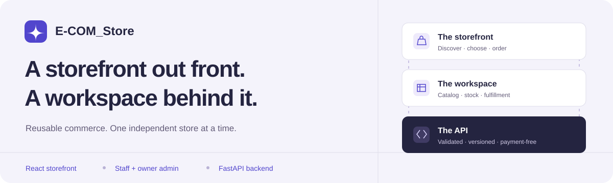
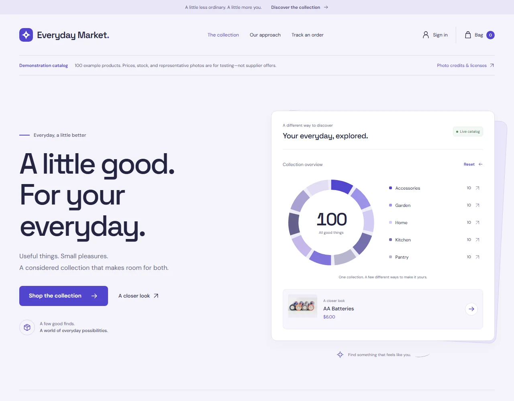
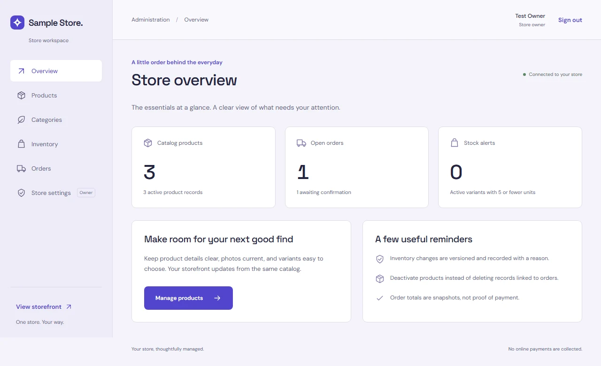
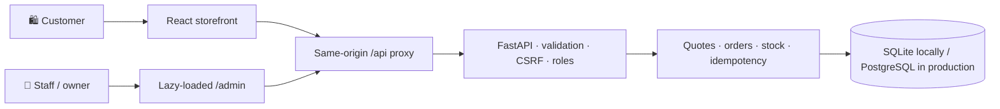

<div align="center">



**A connected storefront. A practical admin panel. One reusable commerce foundation.**

[](frontend/)
[](frontend/)
[](backend/)
[](backend/README.md)
[](#scope-and-safety)

[**Explore the interactive guide**](docs/feature-explorer.html) · [**Get started**](#run-locally) · [**All features**](docs/FEATURES.md) · [**Admin handbook**](frontend/ADMIN.md)

</div>

> **Interactive, in two places.** Expand the sections below directly on GitHub. For searchable
> features, keyboard-operated stack tabs, an expandable project tree, and copyable commands,
> clone/download the repository and open **[`docs/feature-explorer.html`](docs/feature-explorer.html)**
> in a browser. It works offline, with no install or API server. GitHub shows HTML source rather
> than running it; this link is not a deployed live site.

## A look inside

### 🛍️ The customer storefront

[](docs/feature-explorer.html)

Search, explore, choose a variant, fill a bag, and submit a reviewed order. The pale lavender/navy
interface uses self-hosted Space Grotesk and DM Sans, with responsive layouts and keyboard-aware dialogs.

### 🧰 The staff & owner workspace

[](frontend/ADMIN.md)

Real operational counts, editable catalogs, versioned stock adjustments, and fulfillment workflows.
This capture uses synthetic test-store data, not customer data. Storefront photo credits and
screenshot provenance are in [`docs/assets/README.md`](docs/assets/README.md).

## Feature explorer

**Click any section to expand.** For the complete behavior, rules, and limitations, use the
[detailed feature reference](docs/FEATURES.md).

<details open>
<summary><strong>🛍️ Storefront — from discovery to order tracking</strong></summary>

- **Discover:** live category visualization, category filters/reset, server-side search, counts,
  and 12-product pagination. Catalogs over 100 products show a clearly labeled explorer snapshot.
- **Choose:** product descriptions, photos/fallback artwork, attributes, variant options, starting
  prices, availability, and disabled unavailable purchases.
- **Bag:** server-backed session persistence, quantity controls, remove items, subtotal, stock
  validation, and guest/account bag merging at login. A bag does not reserve stock.
- **Checkout:** contact details, optional notes, enabled pickup/domestic shipping/local delivery,
  server-reviewed items, tax, fees, and final totals. No payment is requested or collected.
- **Retry safely:** quote-change detection, durable order idempotency, cross-tab locks, and recovery
  of uncertain submissions using the original details and session.
- **Accounts:** customer registration, sign-in/out, recent order history, and order summaries.
- **Guest tracking:** private reference/key lookup, downloadable guest order details, and pending-order
  cancellation. Private keys stay out of URLs and browser storage.
- **Usability:** responsive layouts, labeled controls, loading/error/empty states, focus-managed
  dialogs, keyboard navigation, and connection recovery.

</details>

<details>
<summary><strong>🧰 Admin panel — catalog, stock, orders, and owner controls</strong></summary>

- **Access:** separate lazy-loaded `/admin`, staff/owner login, API-enforced permissions, CLI-created
  owners, and access revalidation. No public privileged registration.
- **Overview:** total/active products, open/pending orders, and active-variant low-stock alerts
  (five or fewer units). These are operational counts, not sales/payment analytics.
- **Categories:** create/edit names, slugs, descriptions and visibility; inactive categories stay
  editable and recoverable while their products are hidden publicly.
- **Products:** search/filter/page, edit description/category/slug, featured/active flags, flexible
  `key=value` attributes, and up to 10 photo URLs. The current storefront shows the first photo.
- **Variants:** SKU, name, price, options, opening stock, active state, and version-checked metadata
  edits. Existing SKUs are read-only in the UI; stock changes use the dedicated adjustment flow.
- **Inventory:** stock/SKU/version views, low-stock filters, signed adjustments with required reasons,
  stale-write rejection, and durable idempotent retry/recovery across tabs and reloads.
- **Orders:** status filtering, pagination, private contact/address/notes, item/SKU snapshots, totals,
  fulfillment-compatible transitions, status-event timeline, and one-time stock restoration on cancellation.
- **Owner settings:** name, description, email, country, timezone, currency, fixed tax and fee taxation,
  pickup/shipping switches, shipping/delivery fees, and local-delivery postal codes.

**Permissions:** customers shop and view their own orders; staff manage daily operations; owners
also change store settings. Currency locks once variant prices exist. See [admin operations](frontend/ADMIN.md).

</details>

<details>
<summary><strong>🔐 Backend & safety — authoritative, validated, and versioned</strong></summary>

- FastAPI/Pydantic contracts, SQLAlchemy storage, Alembic migrations, SQLite locally,
  and PostgreSQL in production.
- Catalog/variant APIs, API-level price/featured filters and profile edits, sessions, carts,
  reviewed quotes, orders, private guest lookup, and protected management endpoints.
- Argon2 passwords, HttpOnly session cookies, hashed session tokens, CSRF validation,
  allowed hosts/origins, role checks, bounded request bodies, rate limits, and no-store API responses.
- Transactional stock/order operations, PostgreSQL row locks, unique idempotency guards,
  price/currency snapshots, adjustment records and status events.
- Opaque retry metadata in localStorage; not customer contact details, passwords, session bearer
  cookies, guest lookup keys, or stock-adjustment reason text.
- Operator bootstrap/cleanup CLI, interactive OpenAPI docs, non-root Docker image,
  automated tests, audits, and GitHub Actions workflow definitions.

[Endpoint reference & deployment guide](backend/README.md)

</details>

<details>
<summary><strong>📦 General-store demo — 100 products, 10 categories, credited photos</strong></summary>

- **100 initial products**, ten each in Kitchen, Tableware, Home, Stationery, Garden, Accessories,
  Sports, Technology, Personal Care, and Pantry.
- One Standard variant per product, illustrative USD prices, and initial stock of 25.
- **100 local content-hashed WebP images** with pinned Commons source, creator, license,
  SHA-256 and modification metadata; no browsing-time Commons hotlinking.
- Individual CC0/CC BY/CC BY-SA attribution on product details and `/photo-credits.html`.
- Guarded offline import into an initially empty, separately named demo SQLite database.
  Private import identity preserves later admin edits, extra products, prices and stock on restart.
- Separate API **8004**, frontend **5176**, database, random secret/password, and cookie name.
- Optional photo-collection, contact-sheet review and attribution-generation tools.

**Sample merchandise only.** Photos are representative, not exact supplier offers or endorsements.
[Demo setup & licenses](demo/README.md)

</details>

## Tech stack

<div align="center">


</div>

<details>
<summary><strong>See what each layer uses</strong></summary>

- **Interfaces:** React, TypeScript, Vite, TanStack Query, Zod; self-hosted Space Grotesk + DM Sans.
- **API/data:** Python, FastAPI, Pydantic, SQLAlchemy, Alembic, SQLite/PostgreSQL, Argon2.
- **Verification:** Pytest/coverage, Vitest, Playwright, axe-core, Ruff, npm audit, pip-audit.
- **Operations:** Docker, GitHub Actions, static frontend hosting, same-origin HTTPS `/api` proxy.
- **This guide:** HTML, CSS, and vanilla JavaScript. No framework, CDN, tracking, or runtime dependency.

</details>

## How it connects



One independent deployment/database per business. The app intentionally has **no payment gateway**.

## Project tree

<details open>
<summary><strong>🌳 Expand the repository map</strong></summary>

```text
E-COM_Store/
├── frontend/                    # Connected React application
│   ├── src/
│   │   ├── components/          # Discovery, bag, checkout, accounts, tracking
│   │   ├── admin/               # Overview, catalog, stock, orders, settings
│   │   └── lib/                 # API client, schemas, durable retry guards
│   ├── public/demo-photos/      # 100 credited content-hashed images
│   ├── tests/                  # Unit tests
│   └── e2e*/                   # Storefront, admin, demo & guide browser tests
├── backend/
│   ├── app/                    # Routers, models, security, services, CLI
│   ├── migrations/             # Alembic history
│   ├── tests/                  # API, inventory and concurrency coverage
│   └── Dockerfile              # Non-root API image
├── demo/                       # Manifest, guarded import & loopback runner
├── docs/
│   ├── feature-explorer.html   # Open in a browser: interactive offline guide
│   ├── feature-explorer.css    # Responsive visual presentation
│   ├── feature-explorer.js     # Search, filters, tabs, tree & copy buttons
│   ├── FEATURES.md             # Full technical feature reference
│   └── assets/                 # Banner, previews & licensed local fonts
├── .github/workflows/          # Backend and frontend checks
└── README.md                   # You are here
```

Original static prototypes are preserved separately from the connected app. Databases, secrets,
`.env`, dependency folders, build output, and private test artifacts are **not** shipped.

</details>

## Run locally

**Python 3.11+ · Node.js 24 LTS · npm**. Windows PowerShell examples, from the repository root:

<details>
<summary><strong>1. Install dependencies once</strong></summary>

```powershell
py -3.11 -m venv backend/.venv
backend\.venv\Scripts\python.exe -m pip install -r backend/requirements-dev.txt
npm.cmd ci --prefix frontend
```

On macOS/Linux, use `python3`, `backend/.venv/bin/python`, and `npm` instead of `npm.cmd`.

</details>

<details>
<summary><strong>2. Start the demo API and storefront in separate terminals</strong></summary>

**Terminal A — API:**

```powershell
backend\.venv\Scripts\python.exe demo/serve.py
```

**Terminal B — storefront:**

```powershell
Set-Location frontend
$env:STORE_API_TARGET = 'http://127.0.0.1:8004'
npm.cmd run dev -- --host 127.0.0.1 --port 5176 --strictPort
```

- [Storefront](http://127.0.0.1:5176) · [Admin](http://127.0.0.1:5176/admin)
- [API docs](http://127.0.0.1:8004/docs) · [Photo credits](http://127.0.0.1:5176/photo-credits.html)
- **Demo sign-in:** privately open the generated, ignored `demo/.local/access.json`.
  Never publish that file. There is no shared default production password.

For a store without fixtures: [backend bootstrap](backend/README.md) + [frontend setup](frontend/README.md).
Owner creation uses `python -m app.cli create-admin` with a secure password prompt.

</details>

<details>
<summary><strong>3. Open the interactive documentation — no app server needed</strong></summary>

```powershell
Start-Process .\docs\feature-explorer.html
```

Or double-click `docs/feature-explorer.html` after cloning/downloading. Search 24 feature groups,
filter by storefront/admin/platform, change stack tabs, expand folders, and copy setup commands.
No network, account access, analytics, or localStorage is used by the guide.

</details>

## Verification

[](frontend/e2e-docs/guide.spec.ts)
[](frontend/e2e-docs/guide.spec.ts)

<details>
<summary><strong>🧪 Commands and verification scope</strong></summary>

From `frontend/`:

```powershell
npm.cmd test
npm.cmd run build
npx.cmd playwright install chromium
npm.cmd run test:docs
npm.cmd run test:admin
npm.cmd run test:e2e
npm.cmd run test:demo
```

`test:docs` is offline and checks search/filter/reset, stack tabs and keyboard behavior, folder
expansion, command copying, no-script fallback, axe accessibility, and 320–1440px layouts.
`test:admin` starts an isolated temporary database/API. `test:e2e` needs a **disposable seeded API
on 8000**, not a real customer store. Use separate output directories if running suites concurrently.

From `backend/` with its virtual environment active:

```powershell
python -m ruff check .
python -m ruff format --check .
python -m pytest --cov --cov-report=term-missing
python -m pip_audit -r requirements.txt
```

The implementation baseline recorded **64 backend passes**, **3 local PostgreSQL skips**,
**94.57% application coverage**, **23 frontend unit passes**, and **8 admin + 14 storefront + 3 demo
browser passes**. These are recorded local results, not a live CI-status claim. PostgreSQL race
tests need a disposable PostgreSQL database. Automated axe checks do not replace manual review.

</details>

## Scope and safety

> **Payment-free by design.** An order status is not proof of payment. Sample prices, stock,
> zero tax, and representative photographs are not production configuration or supplier offers.

<details>
<summary><strong>Read the boundaries before launching a real store</strong></summary>

Not included: payments/refunds, staff-user management UI, password recovery/email verification,
transactional email/SMS, wishlists/reviews/coupons, uploaded-media storage, carrier tracking,
advanced destination tax, regulated-goods compliance, or a shared multi-tenant marketplace.

Production needs independent PostgreSQL storage/secrets/cookies/domains, HTTPS, a same-origin API
proxy, correct tax/fulfillment, edge limits, monitoring, migrations and restore-tested backups.
The SQLite demo runner and Vite preview are not production servers. Follow individual photo licenses.

</details>

### Pick your starting point

- **`main` / `demo/general-store`:** complete app, interactive docs, and 100-product sample.
- **`feature/reusable-fastapi-store`:** reusable implementation checkpoint `e7dc132`, without the
  general-store fixtures or these later documentation additions.
- The original `Drinks` repository is unchanged by this documentation publication.

---

[Interactive guide](docs/feature-explorer.html) · [Full feature reference](docs/FEATURES.md) ·
[Storefront guide](frontend/README.md) · [Admin handbook](frontend/ADMIN.md) ·
[API & deployment](backend/README.md) · [Demo & photo licenses](demo/README.md)
